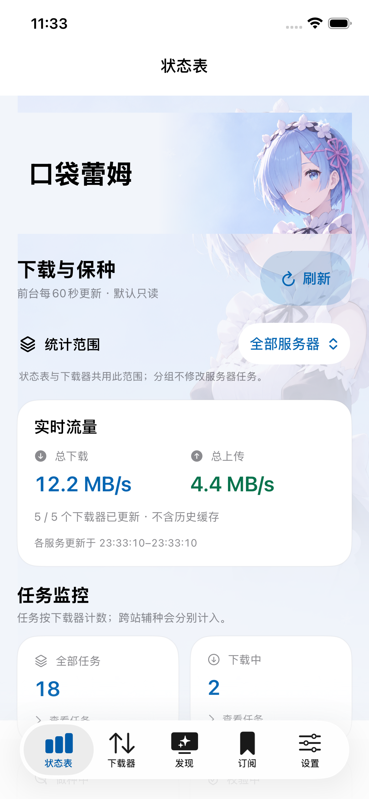
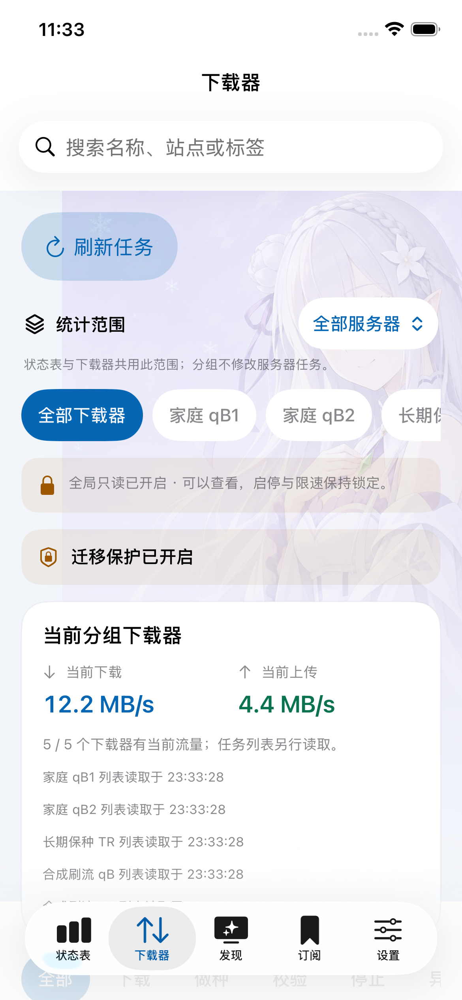
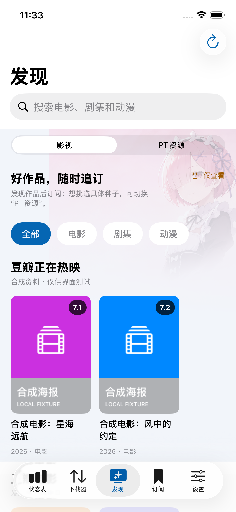
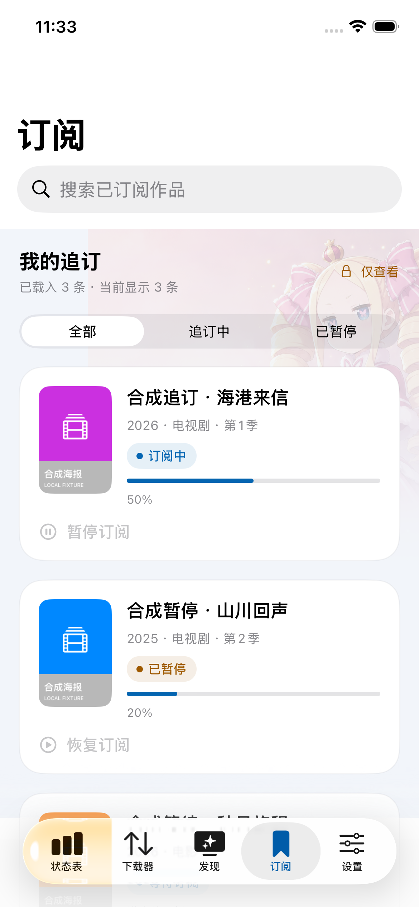
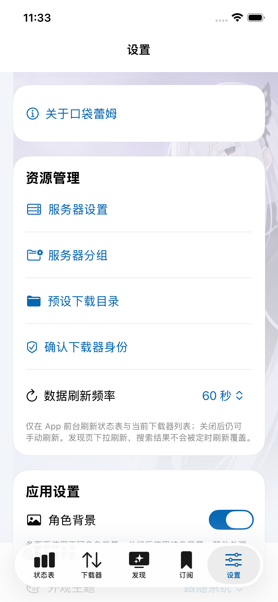

# 口袋蕾姆 · Pocket Rem

一款 iOS 手机管理 qBittorrent、Transmission、刷流盒子与 MoviePilot 的工具。**完全开源、免费、无广告。** iOS 16.1+，原生 SwiftUI，无第三方运行时依赖。

App 直接连接你自己配置的服务器，不使用开发者云端后台或第三方中转。影视资料、PT 搜索和海报由你的 MoviePilot 处理；服务端自身访问资料源、PT 与 Tracker 的行为取决于你的配置。

当前已发布稳定版为 **[2.0.2](https://github.com/dakotazhang/Devilking-MP/releases/tag/v2.0.2)**。支持多台 qB/TR、自定义分组与状态汇总，包含大量做种任务下的切页优化；设置页将“关于口袋蕾姆”置顶、“连接配置”移至底部。安装包、源码和更新说明均可在 [Releases](https://github.com/dakotazhang/Devilking-MP/releases) 下载。

**2.0.3 发布候选正在验证**：任务卡片统一展示下载器已有分类和标签，TR 做种标签也可直接查看；仅复用原任务列表数据，不新增 Tracker 或 PT 请求。影视订阅与手选资源的说明已区分清楚，下载完成后均按 MP 现有整理配置处理，手选不会自动建立持续订阅。

## 五个页面

| 页面 | 用途 |
| --- | --- |
| 状态表 | 按全部服务器或自定义分组，统计上下行速率、下载/做种/校验/停止/异常任务与服务器状态 |
| 下载器 | 添加多台 qB/TR，独立名称、任务搜索、分类与标签、校验状态；授权后单项启停与 Mbps 限速 |
| 发现 | 跟随 MP 的影视推荐；搜索作品并按默认规则订阅，或选择 PT 站搜索具体种子并确认下载 |
| 订阅 | 查看已有订阅与进度；授权后暂停或恢复单条订阅 |
| 设置 | 服务器、分组、确认下载器身份、目录、刷新频率、背景、主题/语言/字体、状态表模块与关于 |

### 页面预览

下列五张图来自 2.0.2 实际运行的 iOS 模拟器，使用明确标注的合成测试资料，不含个人服务器或 PT 账号信息。[查看截图说明](docs/screenshots/v2.0.2/README.md)。

| 状态表 | 下载器 |
| --- | --- |
|  |  |

| 发现 | 订阅 | 设置 |
| --- | --- | --- |
|  |  |  |

qB/TR 数量没有固定槽位限制。每台使用稳定的独立身份，可自由命名为 NAS、家中下载器或刷流盒子。MoviePilot 与旧 Emby 配置各保留一个；本版不提供播放器。

## 分组与连接

在“设置 → 服务器分组”建立“家庭”“刷流”等分类，勾选参与统计的下载器。状态表与下载器页面共用当前范围；选择“全部服务器”时，每台实例仅统计一次。分组可以重叠，删除分组不会删除服务器。

磁盘余量按下载器的默认目录分别展示；多个服务可能共享一块 NAS，**不把这些余量相加当作总空间**。离线、过期或未知数据不冒充当前零流量，聚合显示读取覆盖情况。

- **断开连接**：停止 App 对此服务器的访问，保留地址、账号、凭据、分组和权限；远端任务继续运行。
- **连接**：恢复 App 读取；不会启停种子，不会关闭只读锁。
- **清理凭据**：删除本机登录资料，保留服务器条目和分组，管理权限关闭。
- **移除服务器**：从本机移除连接、凭据及分类关联；不删除远端服务器、任务或文件。

首次添加自己的服务器，或填写 [v2 连接模板](examples/connection.v2.example.dkmp) 后在本地导入。旧 v1 文件与原有连接自动兼容，Bundle ID 和钥匙串服务名保持。只有遗留凭据却没有地址配置时，恢复条目保持断开，需先核对实际地址。配置损坏不会自动清空；显式导入合法备份时，先保留原损坏配置再恢复。

“连接配置”是**从文件批量导入连接资料**的入口，适合首次设置或换机时导入自己准备的配置文件；也可直接在“服务器设置”逐台填写。它不用于修改下载目录，也不会直接开始下载或订阅。导入后默认恢复全局只读，实际操作仍需另外授权；含凭据的原文件请妥善保管。

**真实密码、Token、Cookie、受限链接和个人导入文件不得提交仓库。** 凭据存本机钥匙串，连接与分组保存在本机。

## 用分类和标签标记 PT 站点

先在自己的下载器中给任务设置标记：qBittorrent 可使用**分类或标签**，Transmission 使用**标签（labels）**。例如将站点名称作为标签保存，再回口袋蕾姆刷新任务列表，就能在下载、做种及校验卡片上查看，也可输入相同名称搜索。多个标签会一同展示，完整内容可进入任务详情查看。

App 只显示原任务列表已返回的文字，不自动判断 PT 站点，也不创建或修改下载器标签。未设置或下载器未返回标签时，App 不会补写站名。标签只是你自行维护的标记，不代表 Tracker 汇报或站内做种验收结果；请保留原有用途及保护标签。

## 默认只读与操作确认

全局只读锁默认开启；关闭后仍需逐台授权。每台下载器可单独标记迁移保护，旧 qB1/TR 的保护保持。更名和分组不会改变服务器身份、凭据或权限。

新增订阅可能让 MP 按现有规则搜索并下载，具体种子下载也可能产生站点下载量。每次实际提交均需确认；结果不明确时保存持久待核对记录，跨页面、重启或换目标都不会自动重发。

没有删除远端数据、移动路径、重新校验、批量启停或手动 Tracker 汇报入口。本人发布、正在或等待校验的任务继续受保护。

“确认下载器身份”用于把 MP 内部的下载器，与 App 中同一台实际设备匹配。MP 容器地址与手机使用的地址可能不同，须由用户确认；改名不会取消匹配，删除实例或更换其地址会取消旧匹配。

默认使用 MP 自己的下载目录，也可选它已配置的目录作为本机偏好或单次目标；不改 MP 默认配置。

## 外观与刷新

首页蕾姆横幅显示“口袋蕾姆”；下载器、发现、订阅、设置分别使用爱蜜莉雅、拉姆、碧翠丝、艾姬多娜淡背景，前景海报与按钮保持清晰。背景可关闭，降低透明度时自动隐藏。

支持简体中文与 English (US)、跟随系统/浅色/深色及字体设置。前台刷新可关闭或选 15/30/60/120 秒；切换分组立即读取新范围，后台不持续轮询。独立下载器读取最多 4 路并发。

外出可使用自己已有的 VPN 或有效 HTTPS 服务地址；App 不建立额外公网映射。

## 构建与验证

Mac 安装 Xcode、XcodeGen 后运行：

```sh
bash scripts/build-ios.sh all
```

测试使用合成接口与本地模拟器资料，不连接实际 PT 账号或刷流盒子。无签名 arm64 IPA 可在受支持的 TrollStore 设备安装，或使用自己的证书重签。最低 iOS 16.1，Bundle ID `top.devilkkkkk1.DevilkingMP`。

自动测试覆盖核心/API/操作保护与原生界面流程，包含 5,000 条合成任务、其中 3,500 条 TR 任务的切页、搜索和筛选。2.0.1 的卡顿修正已获 iPhone 17 Pro Max 用户实测确认；2.0.2 的设置排列与五页截图由模拟器回归验证。具体结果见 Release 随附的构建验证说明。

## 关于与许可

作者与维护者：**dk(dakotazhang)** · [GitHub](https://github.com/dakotazhang)。

感谢 [OiiQT](https://github.com/gangz1o/OiiQT) 等社区项目提供功能与协议参考。来源与许可见[致谢](docs/ACKNOWLEDGEMENTS.md)，代码采用 [MIT](LICENSE)，角色素材权利说明见[素材声明](docs/ASSETS.md)。
