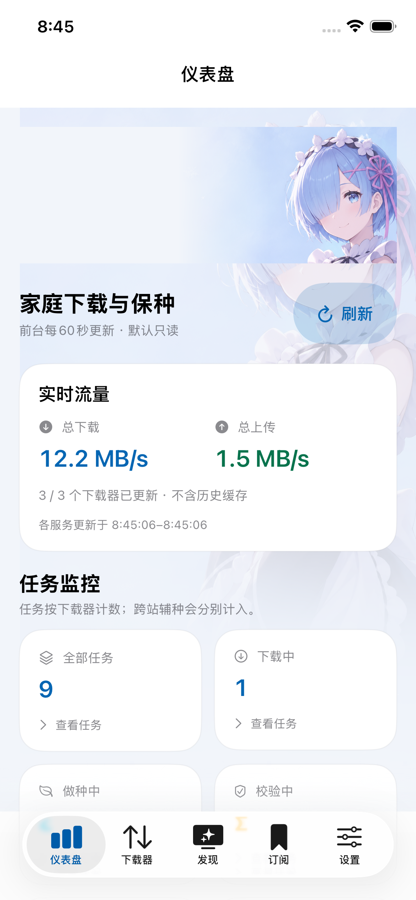
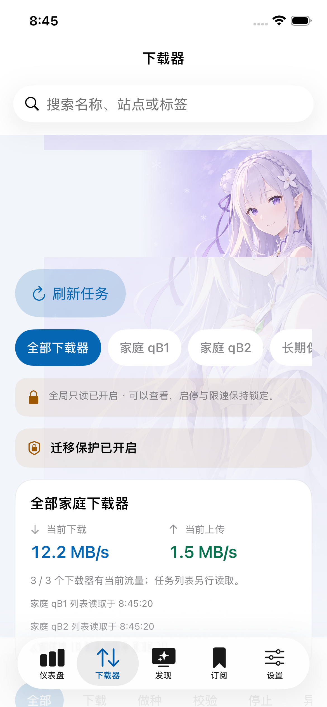
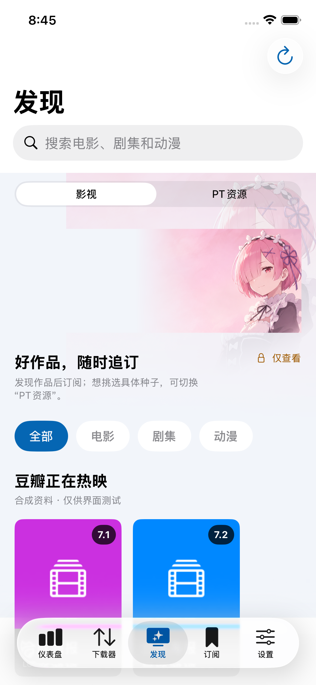
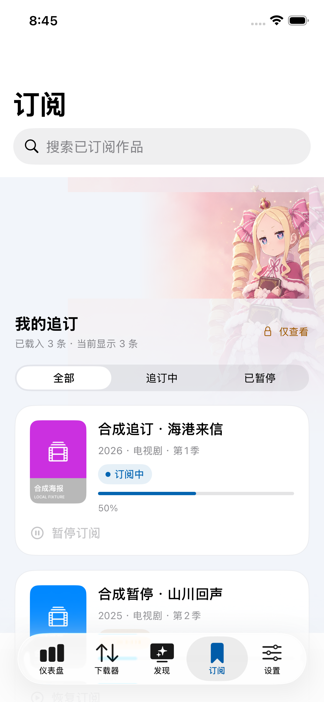
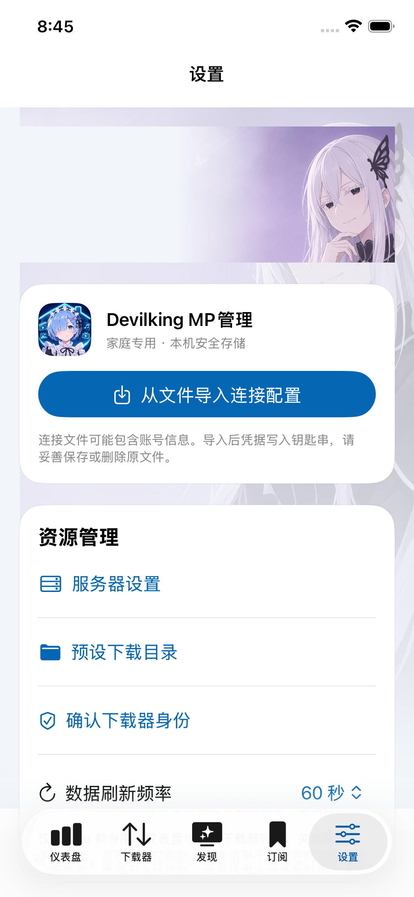

# 1.3.0 测试版模拟器界面

[安装包与完整验收附件](https://github.com/dakotazhang/Devilking-MP/releases/tag/v1.3.0) · [返回项目说明](../../../README.md)

这些图片来自实际运行的原生模拟器，使用 DEBUG 合成资料，不含真实家庭连接、账户或媒体历史；Release 不包含合成测试资料。它们展示简体中文、浅色外观，不能作为英文、深色或真机布局的验收证据。

安装包源码提交为 `f0d94ccf41415b25628a67d2a28500be8d1ef64a`，由 Xcode 26.6 构建；本轮构建运行编号为 `43695585485`。171 项单元、接口与保护测试和 7 项原生模拟器界面流程通过，16 张截图已逐张查看。这里保留五个主页的原始截图，完整 16 张截图及校验摘要见发布附件。

| 仪表盘 · 蕾姆 | 下载器 · 爱蜜莉雅 |
| --- | --- |
|  |  |

| 发现 · 拉姆 | 订阅 · 碧翠丝 |
| --- | --- |
|  |  |

| 设置 · 艾姬多娜 |
| --- |
|  |

角色展示区位于正文前，随内容滚动，不与海报或按钮叠放；装饰可在设置关闭。界面测试同时检查了背景开关、前景海报渲染与只读操作保护。

最低支持 iOS 16.1。同一份无签名 IPA 可用于支持 TrollStore 的设备或使用自己的有效证书重签。1.3.0 在 TrollStore 实机与证书设备上的安装、联网、显示和实际业务操作仍待复测，本版暂为预发布测试版。
